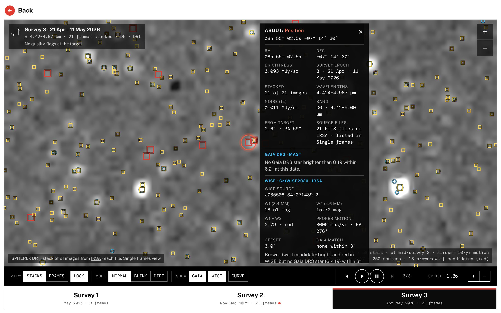
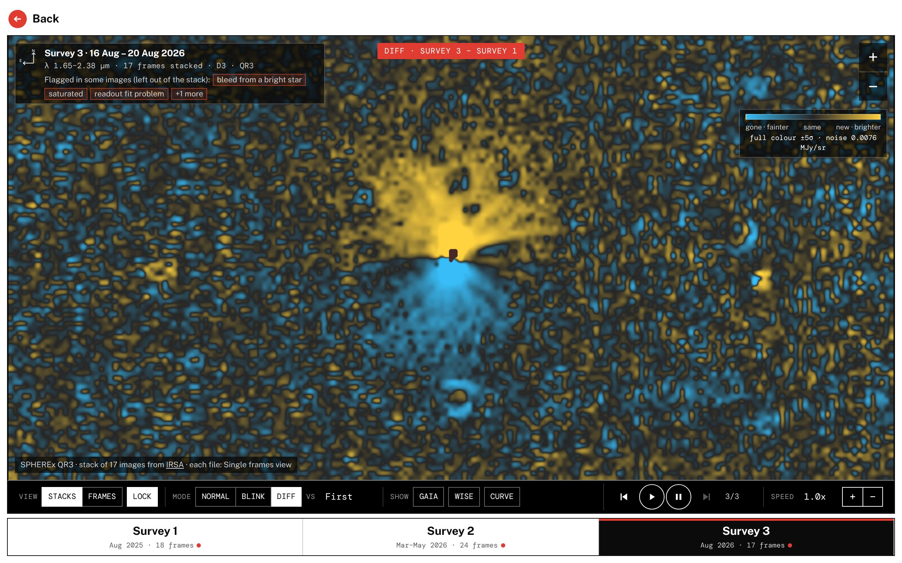
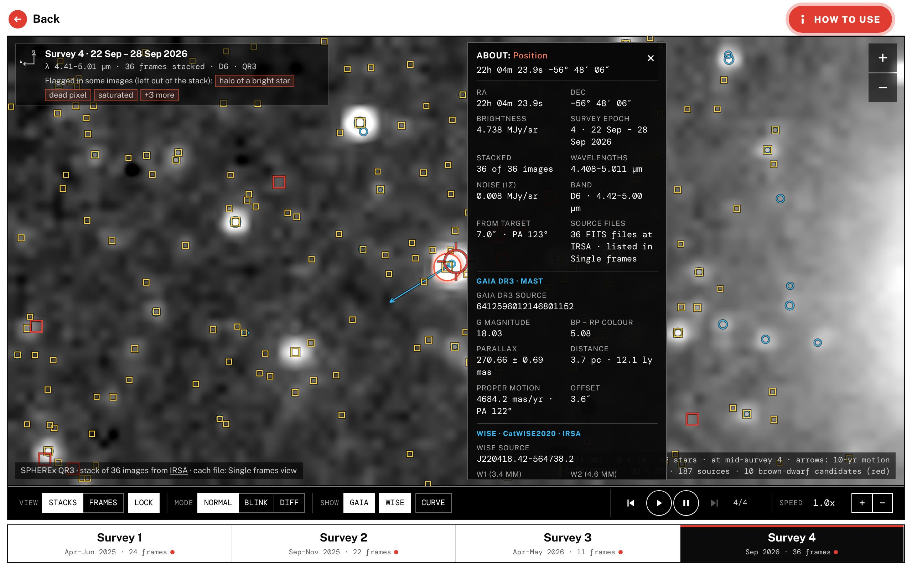
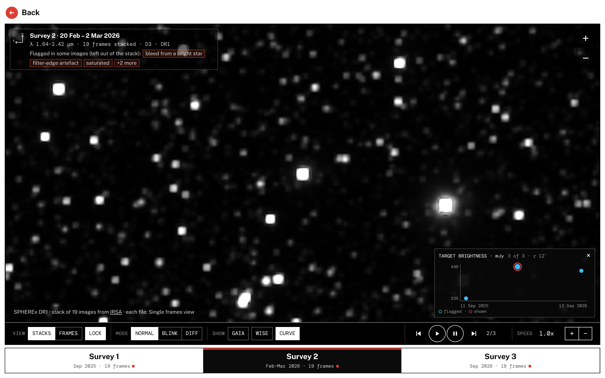
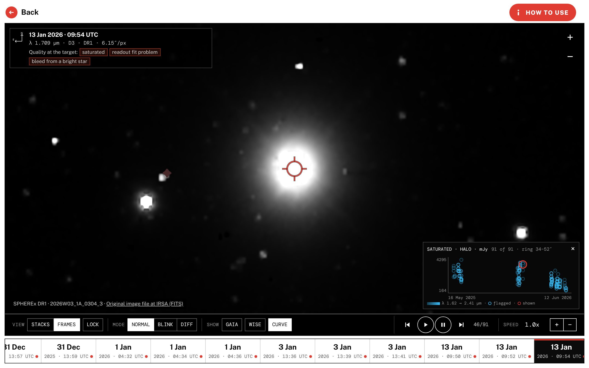

# Anvis

*A SPHEREx time viewer.*

Enter a sky position (RA, Dec) and see every SPHEREx image of that patch of sky in time order,
in a WiseView-style flip-book player. Survey visits can be stacked into clean images; Blink and
Difference modes show what moved or changed; Gaia and WISE catalogues and a light curve help you
judge what you are looking at.

This is an independent tool using NASA SPHEREx data from IRSA; it is not an official NASA website.

## Features

**Page 1 – Pick**
* RA and Dec in degrees or sexagesimal (`14 03 12.5`, `14h03m12.5s`, `−07 14 42`), with live
  checks and plain error messages.
* Field height slider (1′–30′; the width follows the screen) with a download estimate such as
  "~59 frames · ~11 MB".
* Band D1–D6, a **Search** button (Enter works too), and five presets (the challenge targets).
* A plain black grid of the whole sky with degree labels on its edges: hover to read RA / Dec,
  scroll to zoom, click to choose a spot or drag to select an area (RA, Dec and the field height
  fill in; a red ring and a dashed field box mark it). Nothing is downloaded until you press
  **Search**.
* **HELP** (and **HOW TO USE** on page 2): a one-screen explanation of every control in plain words.

**Page 2 – Explore**, controlled from one toolbar:

| Group | Controls |
|---|---|
| **View** | **Stacks** (default): one co-added image per survey visit ("epoch"). **Frames**: every single image. **Lock**: one brightness scale for every image (on for stacks). |
| **Mode** | **Normal**, **Blink** (flip with a reference), **Diff** (current − reference). **VS** picks the reference: previous, first, or any date. |
| **Show** | **Gaia** DR3 stars (MAST), **WISE** sources (CatWISE2020 / AllWISE, IRSA), **Curve**: the target's light curve. |
| Playback | Prev / Play / Pause / Next, counter, speed 0.25x–3x. Keys: ← → step, Space plays, Esc closes the pop-up. |

* **Epoch stacks.** A new epoch starts after a gap of more than 30 days between frames, or when an
  epoch would last longer than 120 days (near the ecliptic poles there are no gaps). Each stack
  is an inverse-variance weighted mean (weights from the `VARIANCE` extension). Pixels with
  bad `FLAGS` bits are left out, except where every frame is flagged (a saturated core), so a
  star never becomes a hole. The noise drops roughly as √N (e.g. 0.012 → 0.004 MJy/sr for 21
  frames).
* **Difference images.** The current image minus the reference, with the sky offset removed. It
  is shown in units of the noise: ±5σ, where σ is the robust noise (1.4826 × MAD) plus 10% of the
  local brightness, so constant stars cancel. Colours: yellow = appeared or brighter, blue =
  disappeared or fainter, gray = no change; a legend explains them. A moving star leaves a
  yellow + blue pair.
* **Light curve.** Aperture photometry at the field centre: a 12″ radius, minus the sky measured
  25–43″ away, in mJy. Click a point to jump to that date. In Frames view the points are shaded
  by wavelength. Hollow points mean "treat with care". Saturated targets (no data at the centre)
  are measured in a ring of their halo, the same ring on every date: a relative brightness.
* **WISE + Gaia.** Both catalogues are moved to each image's date using their proper motions.
  WISE sources matched to Gaia use Gaia's (more precise) motion. **Brown-dwarf candidates**
  (red squares) are bright and red in WISE (W2 ≤ 16, W1 − W2 ≥ 0.4) with no Gaia star within
  3″.
* **Metadata panel.** Date or epoch dates, frames stacked, wavelength (range), band, release, and
  quality flags at the target in plain words (hover for the FITS description).
* **Target ring.** A red ring with four ticks marks the searched position on every image.
* **About pop-up.** Click anywhere for position, brightness, change (in Diff), the nearest Gaia
  star and the nearest WISE source, and links to the original FITS files at IRSA.
* **Shareable URL.** Holds the exact state: position, field, band, view, image shown, mode,
  reference, overlays, lock, curve, speed, zoom and pan.
* **Fits every screen.** Both pages fit with no page scrolling at 1366×768, 1440×900,
  1920×1080 and 390×844 (phones). This is checked by the browser tests.

## The five challenge targets

Each screenshot can be reproduced by opening the link after `http://localhost:8000/`.

### WISE 0855−0714 – the coldest known brown dwarf
`#ra=133.759765&dec=-7.242182&size=300&band=SPHEREx-D6&gaia=1&wise=1&i=2`



**What to look for:**
* Its red **brown-dwarf candidate** square near the centre. The pop-up shows CatWISE
  J085508.34−071439.2 with W1 − W2 = 2.79 (very red), a motion of 8.0″/yr, and *no Gaia
  star*.
* It is invisible at short wavelengths, so use D5/D6 (4–5 µm).
* The link is centred on its 2026 position. The preset uses the brief's coordinates, ~2′ east.
* Over SPHEREx's one-year baseline it moves only ~1.3 pixels, so in Diff mode its +/− pair is
  faint. The motion is clearer in the WISE square moving between epochs.

### Barnard's Star – the fastest-moving star in the sky (10.4″/yr)
`#ra=269.446259&dec=4.768324&size=600&band=SPHEREx-D3&mode=diff&ref=first&i=2`



**What to look for:** Diff, Survey 3 − Survey 1. A yellow (new position) and blue (old
position) **pair**, with yellow to the north: the star moved north by about one pixel in a
year. The constant stars around it fade to gray.

### Epsilon Indi B – a nearby brown-dwarf binary (3.7 pc)
`#ra=331.096669&dec=-56.800649&size=300&band=SPHEREx-D6&gaia=1&wise=1&i=3`



**What to look for:**
* The WISE source at the centre: W1 − W2 ≈ 1.2, red like a cool brown dwarf.
* The same object in Gaia DR3 (6412596012146801152, G = 18.0, parallax 271 mas), with a long
  10-year motion arrow (4.7″/yr).
* Because Gaia does detect it, it is correctly *not* marked as a candidate. CatWISE's own
  motion for this bright, fast binary is poor, so Anvis moves it with Gaia's.

### RW Aurigae – an irregular young variable star
`#ra=76.956526&dec=30.401438&size=600&band=SPHEREx-D3&curve=1&i=1`



**What to look for:**
* The **light curve**: about 347 → 446 → 387 mJy across the three survey visits (±15%), on a
  locked brightness scale.
* Step with Prev / Next, or use Blink with VS = First, and compare the central star with its
  neighbours.

### R Draconis – a Mira variable (period ~245 days)
`#ra=248.167611&dec=66.754979&size=600&band=SPHEREx-D3&view=frames&curve=1&i=45`



**What to look for:**
* The star is saturated (the dark centre is "no data"), so the curve says **SATURATED · HALO**
  and measures its halo in a ring, the same ring on every date.
* The halo brightness changes several-fold between visits as the Mira pulsates. In Frames view
  the points are shaded by wavelength, which also affects brightness.
* Treat the size of the change as approximate: it is a relative measure, not a calibrated
  flux.

## How it works

| Step | Source |
|------|--------|
| Find every SPHEREx spectral image covering the position in the chosen band (collections `spherex_dr1` + `spherex_qr3`) | IRSA SIA service `https://irsa.ipac.caltech.edu/SIA` (tutorial *Introduction to SPHEREx Spectral Images*) |
| Download a small cutout of each image, reading only the first five extensions | IRSA cutout service `<image URL>?center=<ra>,<dec>d&size=<deg>` (tutorial *SPHEREx Spectral Image Cutouts*) |
| Subtract `ZODI` from `IMAGE`; wavelength from the spectral WCS (`key="W"`); quality flags from `FLAGS` | Same tutorials |
| Resample every cutout onto one north-up, east-left grid at 6.15″/px (SPHEREx's orientation changes between visits), with variance and a bad-pixel mask | `app.py` |
| Group into epochs, co-add stacks; difference images, photometry and display in the browser | `app.py`, `static/anvis-math.js`, `static/app.js` |
| Gaia DR3 stars | MAST TAP at STScI |
| CatWISE2020 / AllWISE sources | IRSA TAP; IRSA Gator when TAP is slow or down |

IRSA does not send CORS headers, so a small Python backend (`app.py`) makes the archive requests.
It is polite to IRSA: at most 10 requests at once, retries with backoff, caches, streamed
replies, and partial reads of FITS files. The page is plain HTML/CSS/JS in `static/` (no
framework, no build step).

### API

| Endpoint | What it returns |
|---|---|
| `GET /api/frames?ra&dec&band` | Every image of the position, oldest first, plus its survey `epochs` |
| `GET /api/cutout?ra&dec&size&width&url` | One image resampled onto the field's grid |
| `POST /api/cutouts?ra&dec&size&width` | Many images, streamed back one JSON line each |
| `POST /api/stack?ra&dec&size&width` | One epoch co-added (body `{"urls": [...]}`), with date range, frame counts, wavelength range, noise and flags |
| `GET /api/gaia?ra&dec&radius&gmax` | Gaia DR3 stars (MAST) |
| `GET /api/wise?ra&dec&radius&w2max` | CatWISE2020 (else AllWISE) sources (IRSA) |
| `GET /api/collections[?ra&dec]` | SPHEREx releases in use (and available at a position) |

## Run locally

Needs Python 3.10+.

```bash
pip install -r requirements.txt
```

```bash
python app.py
```

Then open http://localhost:8000 and pick a preset, or open a link such as
http://localhost:8000/#ra=269.446259&dec=4.768324 (Barnard's Star).

Speed: a first search of a position waits for IRSA's image search (about 20 s at the moment;
it is slow on IRSA's side). The five presets are searched in the background when the server
starts, so they open at once; choosing a spot on page 1 starts its search straight away, and
Search reuses it. Repeat searches in the same session are instant.

Settings (environment variables): `ANVIS_COLLECTIONS` (releases, see below), `ANVIS_CACHE_MB`
(memory cache for frames and stacks, default 300), `ANVIS_CACHE` (folder for cached
wavelength tables, default `cache/`).

## Deploy (make it public)

Deploy the folder to any host that runs Python or Docker (Render, Railway, Fly.io, Google Cloud
Run, a VPS, …):

* **Python hosts** pick up `requirements.txt` and the `Procfile`
  (`gunicorn app:app --workers 1 --threads 16 --timeout 300`).
* **Docker hosts:**

  ```bash
  docker build -t anvis .
  ```

  ```bash
  docker run -p 8000:8000 anvis
  ```

Keep **one worker process** (threads are fine), so all requests share the in-memory caches. The
host must be allowed to reach `irsa.ipac.caltech.edu` and `mast.stsci.edu`.

## Adding a new SPHEREx data release

SPHEREx releases appear on IRSA as new collections (e.g. `spherex_qr4`). The app searches the
collections listed in `ANVIS_COLLECTIONS` (comma-separated; default `spherex_dr1,spherex_qr3`),
so a new release needs no code change:

1. See which SPHEREx collections IRSA has at a position (any well-observed field will do):

   ```bash
   curl "http://localhost:8000/api/collections?ra=270&dec=66.56"
   ```

   Each entry shows the collection, a short label, how many images it has there, and whether
   the app already uses it. IRSA has no quick way to list every collection, so this asks about
   one position; at a deep field it can take ~30 s.
2. Add the new collection and restart the app, for example (macOS/Linux):

   ```bash
   ANVIS_COLLECTIONS=spherex_dr1,spherex_qr3,spherex_qr4 python app.py
   ```

   On Windows PowerShell, first run `$env:ANVIS_COLLECTIONS="spherex_dr1,spherex_qr3,spherex_qr4"`,
   then `python app.py`. On a host such as Render, set it as an environment variable.
3. The credit on page 1 shows the releases in use (e.g. "Releases DR1 + QR3 + QR4"), and the
   metadata panel names each image's release.

Notes:
* Only lower-case letters, digits and `_` are accepted; anything else stops the server with a
  clear message.
* Remove a release when a newer one supersedes it, so the same observation isn't shown twice.
* The Deep Survey collections (`spherex_dr1_deep`, `spherex_qr3_deep`) hold many more images
  (tens of thousands near the ecliptic poles); add them deliberately.

## Tests

Offline tests (no network: IRSA and MAST replies are faked; a few seconds):

```bash
pip install -r requirements-dev.txt
```

```bash
python -m pytest -q tests
```

| File | Covers |
|---|---|
| `tests/test_backend.py` | Position and endpoint validation, frame search, retries, partial FITS reads, north-up resampling, quality flags, caches, streaming, Gaia, releases |
| `tests/test_stack.py` | Epoch grouping, stacking maths (synthetic images with known variance), `/api/stack` |
| `tests/test_wise.py` | `/api/wise`: TAP, Gator and AllWISE fallbacks, units, validation |
| `tests/test_compress.py` | gzip-compressed JSON replies |
| `tests/test_math.py` | `static/anvis-math.js` run in Node: coordinate parsing, difference scale, photometry (skipped without Node) |

Live checks against IRSA and MAST (internet needed; on Windows PowerShell first run
`$env:ANVIS_LIVE=1`, then the pytest command):

```bash
ANVIS_LIVE=1 python -m pytest -q tests/test_live.py
```

Browser test of the whole page (needs Node.js; start `python app.py` first, then in
`tests/e2e`):

```bash
npm install
```

```bash
npx playwright install chromium
```

```bash
npm test
```

It prints PASS / FAIL for about 90 checks. They cover both pages, presets, playback, stacks,
Blink / Diff, Lock, the light curve, Gaia, WISE, the shareable URL, simulated IRSA / MAST
failures, and fit and overlap checks at 1366×768, 1440×900, 1920×1080 and 390×844.

## Project layout

| Path | What it is |
|---|---|
| `app.py` | Flask backend: IRSA search and cutouts, frames, epochs and stacks, caches, Gaia (MAST), WISE (IRSA) |
| `static/index.html` | The page: both screens (Pick, Explore) |
| `static/style.css` | Styles |
| `static/app.js` | Everything interactive (its layout is described at the top of the file) |
| `static/anvis-math.js` | Pure functions shared with the tests: coordinates, difference images, photometry |
| `tests/` | Tests (above) |
| `docs/screenshots/` | The screenshots in this README |

## Data credits

* **SPHEREx** images: NASA/IPAC Infrared Science Archive (IRSA), Caltech/IPAC,
  https://irsa.ipac.caltech.edu/Missions/spherex.html. SPHEREx is a NASA mission led by Caltech
  and JPL.
* **Gaia DR3**: European Space Agency mission Gaia (https://www.cosmos.esa.int/gaia), processed by
  the Gaia DPAC, served by the Barbara A. Mikulski Archive for Space Telescopes (MAST) at STScI,
  https://archive.stsci.edu/missions-and-data/gaia.
* **WISE**: CatWISE2020 (Marocco et al. 2021) and AllWISE (Wright et al. 2010; Mainzer et al.
  2014), served by IRSA (https://irsa.ipac.caltech.edu). WISE is a joint project of UCLA and
  JPL/Caltech, funded by NASA; NEOWISE by JPL/Caltech.
* Preset coordinates: SIMBAD (CDS, Strasbourg; queried via its CfA mirror).
* Viewer design modelled on WiseView (Caselden et al. 2018).
